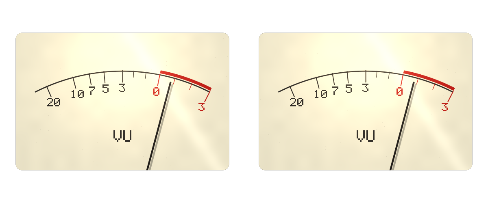
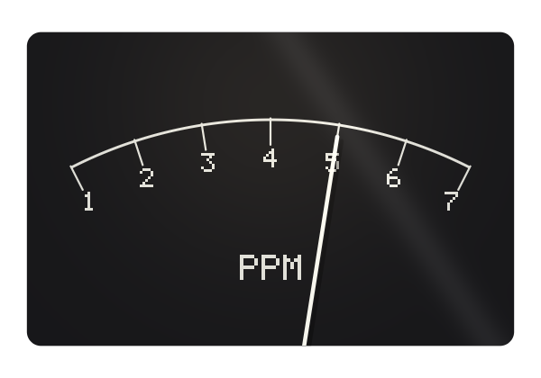
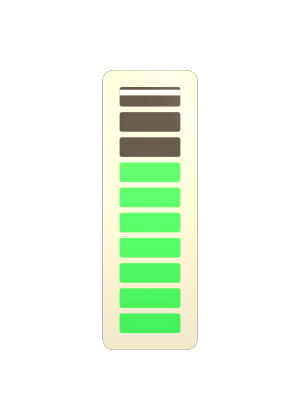
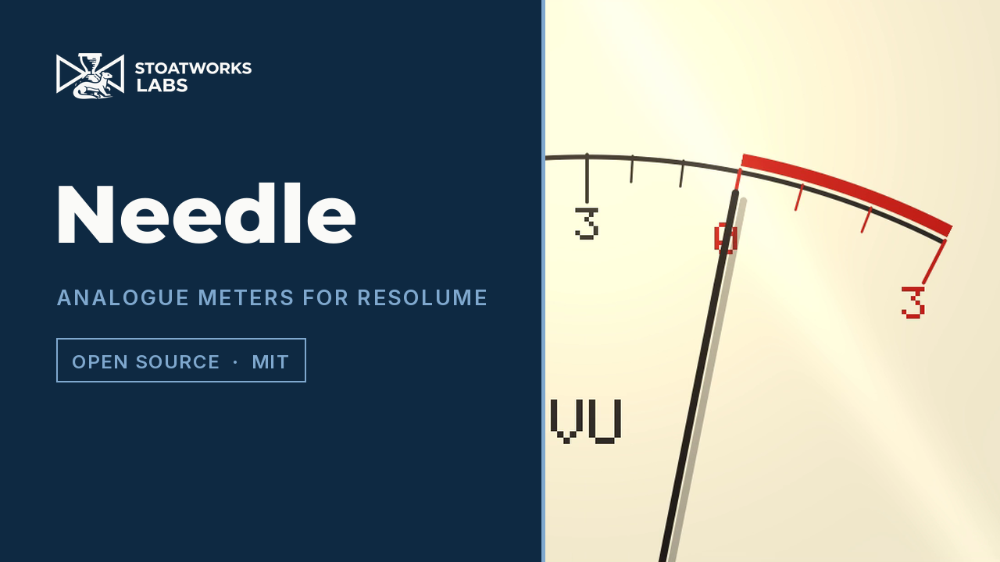
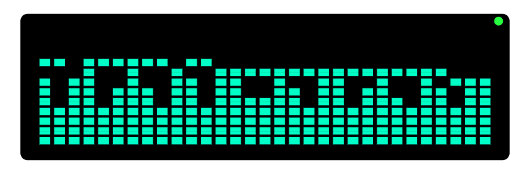

# needle

> **AI-assisted project.** This codebase was created with [Claude](https://claude.com/claude-code)
> (Anthropic), directed and reviewed by a human author. The ballistics come straight out of
> the standards, so they're measured rather than taken on trust, against the CPU engine
> rather than rendered pixels: a step to 0 VU reaches 99 % of its deflection in
> **300.000 ms** and overshoots by **1.2500 %**, a PPM falls 20 dB in **2.800000 s**, and the
> bargraph's ten rungs, found by bisecting on the input, are **3.000000 dB** apart. All 35
> controls change the picture, and the bundle registers and draws under the fleet's oxbow
> host and in Resolume Arena 7.29.0 on a Mac. How all that's measured, and what isn't, is
> in the Status section below.

Audio meters for Resolume Arena and Avenue that move the way their standards say
they should: a VU, a PPM, an LED bargraph and a magic eye, drawn live at the
output's own raster. It's an FFGL **source** plugin.

A stereo pair just past 0 VU, rendered by the plugin's own offline harness
(`ndtest`) rather than captured from Resolume.

<!-- downloads:start -->

## Download

**[v0.2.0](https://github.com/stoatworks-labs/needle/releases/tag/v0.2.0)** — prebuilt for macOS and Windows. Pick your platform:

<b>macOS</b> — Universal (Apple Silicon + Intel)

| Build | Download | Size |
| --- | --- | --- |
| Universal (Apple Silicon + Intel) · .dmg disk image | [`needle-0.2.0-macos-universal.dmg`](https://github.com/stoatworks-labs/needle/releases/download/v0.2.0/needle-0.2.0-macos-universal.dmg) | 609 KB |
| Universal (Apple Silicon + Intel) · .zip archive | [`needle-macos-universal.zip`](https://github.com/stoatworks-labs/needle/releases/latest/download/needle-macos-universal.zip) | 537 KB |

<b>Windows</b> — x64

| Build | Download | Size |
| --- | --- | --- |
| x64 · .exe installer | [`needle-0.2.0-windows-x86_64-setup.exe`](https://github.com/stoatworks-labs/needle/releases/download/v0.2.0/needle-0.2.0-windows-x86_64-setup.exe) | 364 KB |
| x64 · .zip archive | [`needle-windows-x86_64.zip`](https://github.com/stoatworks-labs/needle/releases/latest/download/needle-windows-x86_64.zip) | 249 KB |

All builds, checksums and release notes: [github.com/stoatworks-labs/needle/releases](https://github.com/stoatworks-labs/needle/releases).

macOS builds are signed and notarised and open normally. The Windows builds are unsigned, so SmartScreen warns once.

<!-- downloads:end -->

## The one idea

**You don't get to choose how the needle moves.**

A VU meter is a d'Arsonval movement (a mass on a spring with viscous damping),
which is a second-order system with two free parameters. ANSI C16.5 says two
things about it: a step to 0 VU reaches 99 % of its deflection in 300 ms, and it
overshoots by between 1.0 % and 1.5 %. Two statements about a two-parameter
system leave nothing to taste, so needle solves for both, in code, from the
quoted figures:

    zeta = 0.812716986      omega_n = 13.5119 rad/s  (2.1505 Hz)

Change the quoted figure and the movement changes with it. Nothing here was
tuned until it looked right.

Everything else gets the same treatment. A peak programme meter's 20 dB of fall-back
in 2.8 s *is* a time constant, because an exponential decay in amplitude is a
straight line in decibels: `T = 2.8/ln 10 = 1.2160 s`. Its 5 ms integration
figure gives `T = 3.1616 ms`. The LM3915's ladder is three decibels a rung and
ten rungs.

### What falls out

- **The needle overshoots a kick and settles back**, because 1.25 % of overshoot
  is what the standard asks for, rather than because someone liked the look of an
  ease-out.
- **0 VU sits at 71 % of the arc**, not at 87 %, because a VU scale is linear in
  *voltage* and the scale runs to +3. A BBC PPM's marks are evenly spaced because
  its scale is linear in decibels. Get that backwards and you have a meter that
  reads correctly at exactly two points.
- **A hold bar sits above the bargraph's column** and comes down at a rate you
  choose, because nobody ever standardised that one, and the plugin owns up to it.
- **The magic eye's wings overlap at overload**, which is the thing anyone who
  has used one actually watches for.
- **Wear stops the pointer short rather than slowing it down.** A worn pivot is
  dry friction, not more damping, and the two behave nothing alike: a damped
  movement still arrives, but a dry one stops somewhere inside a dead band and
  stays there, at a different place depending on which way it came. That's why
  people tap a tired meter, and at Wear 1 this one rests 2.0 % of full scale
  short, both ways.

### The four instruments

| | |
|---|---|
|  |  |
| **PPM** — IEC 60268-10 type II. Seven marks, four decibels apart, no red band: a PPM says where the peak is and leaves the judgement to you. | **Bargraph** — the LM3915's 3 dB ladder, ten steps, with a peak hold bar. |

**Magic eye** — a 6U5, with a shadow that closes as the level rises, a warm-up
from cold, phosphor persistence, and a target you can wear out.

*[Watch it](https://www.youtube.com/watch?v=37tMfGAREYU) (55 seconds, with
sound): a VU meter meeting the reference tone, a stereo pair on programme, peak
programme meters and their fall-back, the LM3915 ladder with its hold bar, and
a pair of 6U5 magic eyes. It's all the plugin's own output. An FFGL plugin
doesn't have a window to film, so the footage comes from this repo's offline
harness (`ndtest --pipe`, driven by a cue sheet) rather than a screen recording,
and the soundtrack is synthesised: what you hear is what the meters were fed.*

### A fifth, new in v0.2.0: a VFD spectrum analyser

**VFD** — a 1980s hi-fi spectrum display. 31 third-octave columns (or 10 octaves
summed from them) of twelve 3 dB segments, a peak dot that waits **Peak Hold**
after the bar leaves it, the standard ZnO:Zn blue-green phosphor, four 37.5 µm
filament wires across the glass, and a multiplexed scan you can only see
through a camera **Shutter**. It listens to an audio device you pick, through
the Stoatworks earshot library, because Resolume's 64 bins can't make a
third-octave display; on the other four Types needle never touches your audio
hardware, not even to list it. Until you choose a device in **Audio Input** it
stays dark with an amber status lamp: it never draws from Resolume's spectrum.

> **Photosensitivity warning.** With **Shutter** above 0, the VFD's multiplexed
> scan beats against the frame rate, and a dark band rolls through the display.
> At 60 fps that measured up to **30 flashes a second** in a third of the frame,
> ten times the three a second that broadcast guidance allows (Ofcom, ITU-R
> BT.1702). At Shutter 0, the default, it measured 2 a second or under. Leave
> Shutter at 0 if flashing could affect you or your audience. The measurements are
> under Status.

## Controls

- **Meter**: Type (VU / PPM / Bargraph / Magic Eye), Count (mono or a stereo
  pair), Reference Level (the dBFS the meter calls zero, −18 by default),
  Sensitivity (±12 dB of trim) and Bin Law.
- **Ballistics**: **Standard**, Rise, Fall, Overshoot, Peak Hold, Hold Decay.
  With Standard on, the next three are *out of the model entirely* (every
  constant comes from the specification) and the inspector hides them. With it
  off they're yours, and the result is no longer a movement, on purpose: a rise
  that differs from a fall is a switched system, and no mass on a spring does
  that. Peak Hold and Hold Decay stay live on both settings, because no standard
  specifies them, and are shown on the bargraph, the only meter with a hold bar.
- **Look**: Face and Needle colour, Scale Style, Lamp, Glass, Wear, Persistence
  (shown on the magic eye only).
  **Wear** is the only one of those that isn't purely cosmetic: as well as
  dirtying the glass and dimming the phosphor it puts dry friction in the pivot.
  At Wear 0, which is the default, the movement is bit-identical to a clean one.
- **Layout**: Size, Position, Rotation, Background, Mix.
- **VFD** (shown only on the VFD, which also reads Reference Level,
  Sensitivity, Peak Hold, Hold Decay and the Layout group): Bands (31 Thirds /
  10 Octaves), Multiplex Rate, Shutter, Audio Input, Rescan Inputs, Status Lamp.
  Shutter is 0, the eye, by default; read the warning above before raising it.

Every ballistic default is the value at which Free agrees with Standard for
the quantity it's named after: Rise and Overshoot give the VU's standard
movement, and Fall gives the PPM's standard fall-back (`ndtest --defaults`).
One Rise and one Fall can't be both meters at once, though, so flipping
Standard off at the defaults **isn't** a no-op everywhere: in Free the VU (and
the magic eye) falls over the PPM's 2.8 s instead of its own 300 ms, and the PPM
rises over the VU's 300 ms instead of its own few milliseconds. The switch
alone leaves the VU's rise and overshoot and the PPM's fall right where they
were (`ndtest --free` measures the overshoot as a trajectory, not a constant).

## What it reads, and what it cannot

Resolume gives an FFGL plugin one thing to go on: a 64-bin spectrum, once per
frame. needle takes its level as the RMS over **all** of those bins, which is what
the FFGL SDK's own `ffglqs::Audio` calls the volume. By Parseval's theorem that
follows the signal's power however the bins happen to be laid out in frequency, so
needle doesn't have to make the fleet's long-standing and untested assumption that
they run linearly to Nyquist. Up to v0.1.1 it took the root of the *sum*, 18 dB
higher, and on a real Resolume rig that pinned the needle at the default Reference
Level ([#1](https://github.com/stoatworks-labs/needle/issues/1)).

That leaves three limits, and I'd rather you knew about them up front:

- **The calibration is nominal.** Whether a full-scale sine produces a bin of 1.0
  depends on the host's window and normalisation, which nothing here can
  discover. The SDK's footing is a better-grounded guess than the sum was, but
  it's still a guess rather than a measurement. Reference Level and Sensitivity
  are how you put the needle where your programme actually sits.
- **It isn't a true-peak meter.** A magnitude spectrum has no phase, so the
  time-domain peak inside the block can't be got back from it. The PPM and the
  bargraph are driven by a block RMS: on a sine that's 3.01 dB below a real PPM,
  and on peakier material it's further below by that material's crest factor.
  The *ballistics* are the standard's to the letter. The *detector* isn't.
- **A stereo pair is two instruments on one spectrum.** FFGL has one audio buffer
  to give, so both meters read the programme. A pair of VUs is the instrument
  people recognise, but it isn't two measurements.

## Status

**v0.2.0, released on 2026-11-19, adds the VFD (v0.1.2 on 2026-10-11, v0.1.0 and v0.1.1 on
2026-09-23). Still early days.**

User guide: [docs/USER-GUIDE.md](docs/USER-GUIDE.md), also at
https://stoatworks-labs.com/software/needle/guide/

What I've verified by measurement on this Mac (Apple Silicon, macOS 26.4):

- **ANSI C16.5.** 99 % of a step at **300.000 ms** (allowed 300 ± 5), overshoot
  **1.2500 %** (allowed 1.0–1.5). The oversampled integrator tracks the exact
  closed-form step response to better than **1e-12** of full scale.
- **IEC 60268-10 type II.** 20 dB of fall-back in **2.800000 s** (allowed
  2.8 ± 0.05); a 5 ms burst reads **2.000000 dB** below the same tone held.
- **The LM3915 ladder.** Ten thresholds recovered by bisecting on the input,
  every gap **3.000000 dB**, the top rung exactly at the reference and the bottom
  at −27.000 dB.
- **The magic eye.** The shadow never widens as the level rises across a 60 dB
  sweep, is 100° wide open, is shut at the stated overload to seventy times finer
  than one pixel of arc at 4K, and the wings overlap 15° at +6 dB.
- **Frame one.** A clip triggered at t = 40 s integrates nothing on its first
  frame and reaches 99 % at **300.24 ms**, the same to 2.5 µs as one triggered
  at zero.
- **Frame rate.** Half a second of the same signal reads **0.712908590** at 24,
  30, 50, 60 and 144 fps, with a spread of exactly zero.
- **A worn pivot.** At Wear 1 the pointer stops dead **2.0 % of full scale**
  short of its target, inside the 3 % dead band the friction implies, and at a
  different place depending on which way it came. At Wear 0 it's bit-identical
  to a frictionless movement at every one of 9,600 steps.
- **Free, as a trajectory** (`--free`). Over 36 steps (six Rise/Fall pairs
  from 20 ms/20 s to 2 s/50 ms, three Overshoots, up and down), a step in the
  faster direction overshoots by exactly the Overshoot, the slower by less, and
  each reaches 99 % in exactly its own Rise or Fall. At the shipped defaults a
  step to 0 VU overshoots **1.2500 %**; v0.1.1's switching rule gave 11.6 %, and
  the same check fails on it. On programme the needle stays within the
  programme's range plus what its Overshoot can carry, on every setting tried.
- **The stop.** 24 dB over 0 VU the pointer rests at 1.035 of full scale and
  leaves within a frame of the level going; v0.1.1's ran on to 11 times full
  scale and stayed pinned 217 ms.
- **The level law** is the FFGL SDK's own volume to 1e-3 dB on four spectra, and
  every bin at an SDK volume of −18 dB reads 0 VU at the default Reference Level
  (`--defaults`).
- **A Stereo Pair after Mono and back.** Both meters read the same, bit for bit,
  on every paired frame, on all four Types, whether the level fell or rose while
  the right one was hidden. v0.1.0 froze the hidden meter, and the same check
  catches that on 8 of 8 scenarios (fixed in v0.1.1).
- **The picture.** Pixel-exact draws at 640×360 and 1920×1080; all **35**
  controls change it (`tools/sweep.py`; Audio Input and Rescan Inputs reach real
  devices, so `ndtest --devices` covers those two on a scripted backend instead);
  the bundle is universal, exports `plugMain`, signs, and passes `oxbow selftest`
  as `ND01` / Needle / source.
- **Cost**, `ndtest --bench`: **under 0.03 ms/frame at every raster from 720p to
  4K**, which is under a fifth of one per cent of a 60 fps frame. That's as
  precise as the measurement gets: one pass is so cheap that the number
  is dominated by scheduling rather than by the shader, and back-to-back passes
  at 4K have spanned 0.020 to 0.077 ms on an otherwise idle machine. The bench
  quotes its fastest pass of five with the spread printed beside it; a single
  average there would be measuring the machine's mood. It's an Apple Silicon
  figure; nothing has timed a frame on Windows or on an Intel Mac.

On GitHub, 2026-09-23: `ci.yml` runs on GitHub's macOS runner, which has no GPU,
so the harness falls back to Apple's software renderer (a second rasteriser).
The physics checks (`--ballistics --ppm --steps --eye --prime --rate --friction
--defaults --names --font`) passed on the runner; the pixel and sweep steps
passed there too (`ndtest --pixels`, and the sweep at 160x90). The Windows x64 DLL was compiled with MSVC on GitHub's Windows runner and
the job passed. On 2026-11-16 (e512e2b) the same job compiled earshot and its
miniaudio with MSVC, so the VFD builds for Windows. It has since run there in
Arena with no device (below). From
v0.2.0 the macOS job also runs the VFD's no-GL checks (`--iec`, `--hold`,
`--coreaudio`).

**The VFD (measured on this Mac on 2026-11-16 and again on the v0.2.0 tree on
2026-11-19, `ndtest`, all on a scripted capture backend fed through earshot's
`feed()`):**

- **IEC 61260 class 1 bands** (read in IS 6964, its identical adoption): every
  centre within half a unit of Table A.1's five printed figures, every label
  Table A.1's; a sine at each midband reads **0.001 dB** at worst in its own
  band (allowed ±0.3), and at every band edge **3.010 dB** down (allowed 2.0–5.0).
  A sine's neighbours read at least **1.50 dB** further down than class 1 asks, and the
  picture lights exactly what those levels imply. The 10 octaves meet the octave
  mask (worst 0.128 dB in band, neighbours at least 35.9 dB down).
- **The peak hold is frame-rate independent:** at 24, 30, 60 and 144 fps the dot
  holds **1.5 s ± one frame** after the bar leaves it and falls at
  **12.000000 dB/s**, and it doesn't move during an 8 s note.
- **The picture**: a camera exposure of two whole scans gives the eye's picture
  to **0** code values; a 1/8000 s shutter rolls down the picture at the rate the
  readout implies (0.06864 against 0.06889 columns a row); host time 499,000 s
  draws what 0 s draws; each wire darkens a segment by its own width
  (0.2769 px against 0.2779); every segment edge sits within **0.002 px** of the
  spec's millimetres; the phosphor decodes onto the line from D65 to Noritake's
  (0.24, 0.41). Each of those at 1280×720 and 320×180, on the GPU and on Apple's
  software renderer.
- **VFD off doesn't touch CoreAudio**: with the real backend, every control on
  all four meters builds no audio engine, lists no device and opens none. And the
  four meters render **byte-identically** to v0.1.2's source in 72 scenes on the
  GPU and 36 on the software renderer.
- Every check has a planted bug it catches (`ndtest --negative`), and every
  one-character shader mutant in `tools/mutate.sh` is caught by the check it
  targets (and its no-op edit is not).
- **Cost**, `ndtest --bench` on the v0.2.0 tree: **0.589 ms a frame at 720p and
  0.601 at 1080p** with the VFD on (3.5 to 3.6 % of a 60 fps frame), against
  0.011 and 0.014 ms for the meters (0.583, 0.593, 0.015 and 0.013 on 2026-11-16). It barely moves with the raster, so it's the audio analysis, not the
  shader: the figure includes earshot's update and the harness feeding it.
- **Flashing** (2026-11-19). `ndtest --pipe` rendered 15 s clips at 1280×720 and
  60 fps, with the demo clips' audio fed through `--pcm`: 30 clips for each
  ballistic setting, 8 for each camera setting, then one clip for each further
  pair of shutter speed and scan rate. A flash checker counted transitions in linear
  luminance (a change of a tenth of white, with the darker end below 0.8, over
  the whole frame and in each third-of-frame window). Results:
  - At the defaults the worst window measured **1.0 flash a second**, and the
    whole frame 0.
  - With the fastest ballistics (Size 1, Sensitivity 1, Peak Hold 0.1, Hold
    Decay 1, thirds or octaves), the worst window measured **2.0**.
  - **With Shutter above 0 it crosses three a second.** The scan beats against
    the frame rate, and a dark band rolls through part of the display. Worst
    windows, at Size 1 and Sensitivity 1:
    - 1/60 s at 50 Hz: 10.5 a second.
    - 1/125 s at 50, 70 and 100 Hz: 10.5, 10.5 and 19.
    - 1/250 s and 1/500 s at 100 Hz: 20; at 150 Hz: 30.
    - At the default Size: 10 at 1/125 s and 50 Hz, and at 1/250 s and 100 Hz.
    - 1/1000 s and shorter catch too little of the scan to count, and every
      setting tried at 200 Hz stayed under 1.
  - The whole frame never crossed three a second.
  - The striped pattern of segment rows and wires peaked at **21.6 %** of the
    frame and was never over a quarter of it for any second. A quarter of the
    screen is where Ofcom's and ITU-R BT.1702's pattern guidance starts.
  - The defaults stay as built. Hence the warning at the top.
- **In Resolume Arena 7.29.0 on this Mac** (2026-11-19, over Arena's REST API):
  - Type = VFD with Audio Input left on None (host FFT) was dark with its amber
    lamp. That held while Resolume's `Beat 001.wav` played and Arena's log said
    audio was reaching the layer, so the VFD did as designed and drew nothing
    from Resolume's spectrum.
  - The plugin listed 12 devices in the menu and opened none, so no microphone
    prompt came. Status Lamp Off removed the lamp. 10 Octaves stayed dark.
  - Back on the VU, the frame matched the one from before the switch, code value
    for code value.
- **In Resolume Arena 7.27.1 on Windows** (2026-11-19, over Arena's REST API).
  This was the v0.2.0 release zip's own `Needle.dll` on win-lab, an x64
  Windows 11 VM with no GPU (Mesa llvmpipe) and no sound device.
  - Type = VFD, set by value, rendered the same picture as on the Mac,
    scaled to the frame. The lamp sat at (993, 259) of 1280×720, against
    (1490, 389) of 1920×1080 on the Mac, in the same amber (mean RGB 247, 153,
    13 against 250, 155, 13).
  - With no device it was dark with its amber lamp and lit no segment. Ten
    thumbnails over about 10 s were identical.
  - Arena listed the same 26 controls as on the Mac. The plugin listed 0
    devices and opened none, and Audio Input stayed on None (host FFT).
  - Every other control Arena lists on the VFD was tried: each range at both
    ends and each choice through every option, then put back. That covered
    Reference Level, Sensitivity, Peak Hold, Hold Decay, Size, Position X and
    Y, Rotation, Background and its colour, Mix, Bands, Multiplex Rate, Shutter
    and Status Lamp. Rescan Inputs was pressed once, and it listed 0 devices
    again.
  - Arena answered after every write and stayed one process, with the same
    pid throughout. Its log gained no error lines.
  - With nothing lit, the controls that act on lit segments (the levels, the
    peak hold, Bands, Multiplex Rate and Shutter) left the picture unchanged.
    Size, Position, Rotation, Background and Mix changed it as they should,
    and Status Lamp Off removed the lamp.
  - Back on the VU, the frame matched the one from before the switch exactly,
    and Arena listed 31 controls again.

What isn't verified for the VFD:

- It has been in Resolume only with no device chosen. It has never run in a host
  with a real audio device.
- So the macOS microphone prompt hasn't been seen.
- Whether Resolume refreshes the device menu after **Rescan Inputs** is unknown.
- On Windows, earshot has run only on a machine with no sound device, where it
  listed none.

What isn't verified yet:

- **Resolume on macOS: one session, over REST.** Everything before this list is
  the offline harness, which drives the real plugin class in a headless GL
  context. On 2026-11-19 the v0.2.0 bundle ran in Resolume Arena 7.29.0 on this
  Mac, driven through Arena's REST API.
  - It loaded from Extra Effects and mounted as `SW Needle`.
  - Arena honours the hiding. It lists 31 of the 43 parameters on a VU with
    Standard on, and 26 on the VFD. There the six VFD controls and Peak Hold and
    Hold Decay appear, and the needle's face and glass controls go.
  - A VU in silence is still: two snapshots read identical. Mix 0 is
    transparent.
  - Resolume's own `Beat 001.wav` played on the layer below, with the Audio
    buffer on Composition. **All four meters moved, but low.** At the default
    Reference Level and Sensitivity the VU rose only to about −20 VU and the PPM
    stayed on its stop. At Sensitivity 1 the VU reached about −15 and the PPM
    about mark 2. That is the nominal calibration described above; Reference
    Level and Sensitivity are the remedy.
  - How the controls look in Arena's inspector hasn't been looked at.
- **Three of the quoted figures came from background knowledge and were not
  checked against a document**: the PPM's "2 dB below steady for a 5 ms burst"
  (used instead of the looser "about 80 %"; they're the same requirement,
  since 10^(−2/20) is 79.43 %), the BBC PPM's seven marks at four decibels, and
  the 6U5's 100-degree shadow angle. `AGENTS.md` separates those from the
  figures that were supplied, and each names the single constant to change if it
  turns out to be wrong. Only the first can affect a ballistic claim.
- **Windows in Resolume Arena:** the v0.2.0 release zip's own DLL went through
  the fleet's Arena gate on 2026-11-19 (Resolume Arena 7.27.1 on win-lab, Mesa
  llvmpipe, no GPU) and passed 9 of 9, with one SKIP it owned up to. It loads from
  Extra Effects, registers as `SW Needle` / `ND01` / **source**, is listed among
  Arena's sources, the 31 controls Arena lists at the defaults (a VU with Standard
  on; the rest are hidden) match the declaration in name, order, type, range and
  default, it renders a meter, and Arena's log stays clean. 21 controls measurably
  moved the picture (4 of them under a precondition, such as Background on for the
  background colour); the 5 that act on audio (Reference Level, Sensitivity, Bin
  Law, Standard and the Audio input) were skipped, because win-lab has no sound
  device. The gate tries only the first three Types, so the VFD was then run by
  hand in the same Arena that day (above, under the VFD). It rendered and stayed
  dark with its amber lamp with no device, and none of its controls upset Arena.
  Windows hasn't heard real audio, and neither check says anything about speed or
  a real GPU.
- **Real audio in a host**, only twice:
  - A user's Resolume rig running v0.1.1
    ([#1](https://github.com/stoatworks-labs/needle/issues/1)), which is how the
    18 dB error was found.
  - Resolume's demo loop in Arena 7.29.0 on this Mac (above).

  The universal build has never run on an Intel Mac.
- **The host's audio buffer is uncalibrated and its bin law is unmeasured** (see
  above). `Bin Law` exists because the fleet disagrees with itself about it.
- **Text is pixel-exact only at Rotation 0.** Rotate the instrument and the
  labels are resampled.
- No factory presets, no OpenFX port.

## Browser demo

**<https://needle-demo.stoatworks-labs.com>** runs the four meters as the plugin's
own shader, copied unedited into WebGL2, over a JavaScript port of its meter
engine, level law, parameter conversions and layout, and the **VFD** as the
plugin itself: its C++ and earshot's, compiled unmodified to WebAssembly.
**There's no audio and no microphone in the page.** The meters are driven by a
generated test signal (a 0 VU step, a −20 dB step, 5 ms bursts, a ladder of
burst lengths, pink noise), which the page itself shapes into a 64-bin spectrum.
That isn't Resolume's FFT (the host's calibration is unknown and isn't
reproduced), and the port's only check is someone reading it. The VFD is fed
generated signals (a drum-and-bass track, the test harness's own programme,
third-octave tones, a sweep, pink noise, silence) through earshot's `feed()`,
the path a capture device's samples take; the page never lists or opens an
audio device, so Audio Input and Rescan Inputs aren't on its panel. The shader
copies, the harness's signal and the WebAssembly's inputs are checked by
`demo/tools/check_shaders.py`, run by `tools/verify.sh`, and the VFD's pictures
match the test harness's to within one code in a few dozen pixel values
(`demo/tools/crosscheck.py`). The page carries a photosensitivity warning: with
Shutter above 0 the VFD's scan rolls a dark band through the display at up to 30
flashes a second in part of the frame; at Shutter 0, the default, it stays at 2
a second or under. See
`demo/README.md`.

## Installing

Copy `Needle.bundle` (macOS) or `Needle.dll` (Windows) into

    ~/Documents/Resolume Arena/Extra Effects        (or "Resolume Avenue")
    Documents\Resolume Arena\Extra Effects           (Windows)

then restart Resolume. It shows up under **Sources**.

## Building

    git clone --recursive https://github.com/stoatworks-labs/needle
    cmake -B build -DCMAKE_BUILD_TYPE=Release
    cmake --build build
    cmake --install build          # into Arena's Extra Effects, macOS

The macOS build is universal (arm64 + x86_64) by default; add
`-DCMAKE_OSX_ARCHITECTURES=arm64` for a quicker development build. Windows needs
GLEW from vcpkg, and `.github/workflows/release.yml` has the full configure
line.

## Building and testing

The offline harness drives the real plugin class. Thirteen of the meters' fifteen
check groups don't open a GL context at all, because their claims are about a
differential equation, and a rasteriser has no opinions about those (the VFD's
bands and hold are measured the same way):

    ./build/ndtest --ballistics     # ANSI C16.5, solved and measured
    ./build/ndtest --ppm            # IEC 60268-10 type II
    ./build/ndtest --steps          # the 3 dB ladder, by bisection
    ./build/ndtest --eye            # the shadow, across a 60 dB sweep
    ./build/ndtest --prime          # frame one, and a clip trigger at t = 40 s
    ./build/ndtest --rate           # 24, 30, 50, 60 and 144 fps agree
    ./build/ndtest --friction       # a worn pivot, and what it does not touch
    ./build/ndtest --pair           # a Stereo Pair agrees after Mono and back
    ./build/ndtest --pixels         # and the one check that reads a rasteriser
    ./build/ndtest --iec            # the VFD's bands against IEC 61260 class 1
    ./build/ndtest --hold           # its peak hold at 24, 30, 60 and 144 fps
    ./build/ndtest --geometry       # its segments where the millimetres say
    ./build/ndtest --coreaudio      # and VFD off never reaches an audio device
    ./build/ndtest --negative       # every planted bug is caught
    tools/mutate.sh                 # every one-character shader mutant is caught
    ./build/ndtest --bench          # 720p through 4K
    ./build/ndtest --out /tmp/f.png --size 1920x1080 --level -18 --set "Type=1"
    python3 tools/sweep.py          # no control is silently dead
    tools/verify.sh                 # all of it

## Diagnostics

needle writes a plain-text log every time it runs:

    ~/Library/Logs/needle/needle.YYYY-MM-DD.log                          (macOS)
    %LOCALAPPDATA%\needle\logs\needle.YYYY-MM-DD.log                     (Windows)
    ${XDG_STATE_HOME:-~/.local/state}/needle/logs/needle.YYYY-MM-DD.log

It records the build, the GL driver, the solved ballistic constants, what unit
the host's clock turned out to be in, and whether any audio reached the layer.
That last one is the commonest reason a meter doesn't move.

<!-- attributions:start -->
This project is built on other people's work — see [ATTRIBUTIONS.md](ATTRIBUTIONS.md).
<!-- attributions:end -->

## Licence

MIT. See [LICENSE](LICENSE).

The specifications the ballistics are solved from (ANSI C16.5, IEC 60268-10,
the LM3915's divider chain, the 6U5's shadow angle) are published numbers rather
than anybody's source. Nothing was copied from any implementation of them.
