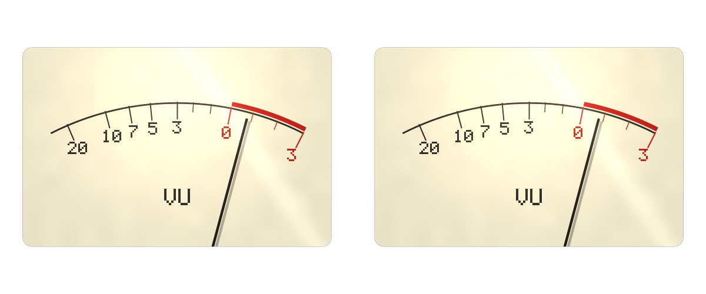
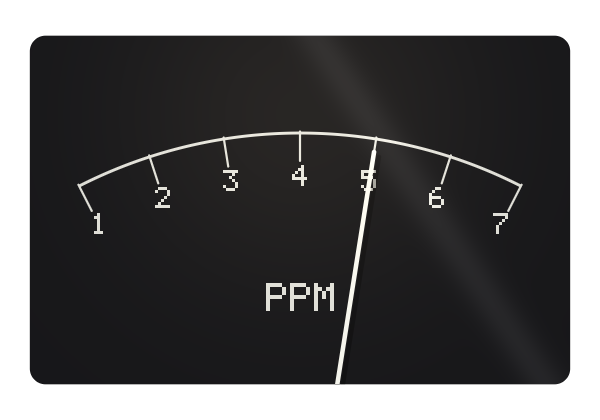
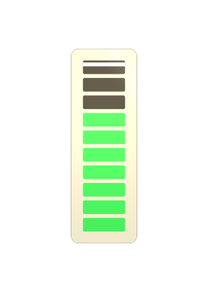
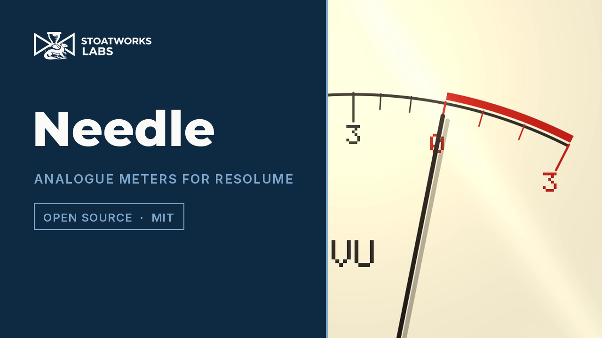

# needle

> **AI-assisted project.** This codebase was created with [Claude](https://claude.com/claude-code)
> (Anthropic), directed and reviewed by a human author. The ballistics come straight out of
> the standards, so they're measured rather than taken on trust, against the CPU engine
> rather than rendered pixels: a step to 0 VU reaches 99 % of its deflection in
> **300.000 ms** and overshoots by **1.2500 %**, a PPM falls 20 dB in **2.800000 s**, and the
> bargraph's ten rungs, found by bisecting on the input, are **3.000000 dB** apart. All 31
> controls change the picture, and the bundle registers and draws under the fleet's oxbow
> host. **It has never been loaded into Resolume on a Mac.** How all that's measured, and
> what isn't, is in the Status section below.

Audio meters for Resolume Arena and Avenue that move the way their standards say
they should: a VU, a PPM, an LED bargraph and a magic eye, drawn live at the
output's own raster. It's an FFGL **source** plugin.

A stereo pair just past 0 VU, rendered by the plugin's own offline harness
(`ndtest`) rather than captured from Resolume.

<!-- downloads:start -->

## Download

**[v0.1.2](https://github.com/stoatworks-labs/needle/releases/tag/v0.1.2)** — prebuilt for macOS and Windows. Pick your platform:

<b>macOS</b> — Universal (Apple Silicon + Intel)

| Build | Download | Size |
| --- | --- | --- |
| Universal (Apple Silicon + Intel) · .dmg disk image | [`needle-0.1.2-macos-universal.dmg`](https://github.com/stoatworks-labs/needle/releases/download/v0.1.2/needle-0.1.2-macos-universal.dmg) | 241 KB |
| Universal (Apple Silicon + Intel) · .zip archive | [`needle-macos-universal.zip`](https://github.com/stoatworks-labs/needle/releases/latest/download/needle-macos-universal.zip) | 198 KB |

<b>Windows</b> — x64

| Build | Download | Size |
| --- | --- | --- |
| x64 · .exe installer | [`needle-0.1.2-windows-x86_64-setup.exe`](https://github.com/stoatworks-labs/needle/releases/download/v0.1.2/needle-0.1.2-windows-x86_64-setup.exe) | 231 KB |
| x64 · .zip archive | [`needle-windows-x86_64.zip`](https://github.com/stoatworks-labs/needle/releases/latest/download/needle-windows-x86_64.zip) | 122 KB |

All builds, checksums and release notes: [github.com/stoatworks-labs/needle/releases](https://github.com/stoatworks-labs/needle/releases).

macOS builds are signed and notarised and open normally. The Windows builds are unsigned, so SmartScreen warns once.

<!-- downloads:end -->

## The one idea

**You don't get to choose how the needle moves.**

A VU meter is a d'Arsonval movement (a mass on a spring with viscous damping),
which is a second-order system with two free parameters. ANSI C16.5 says two
things about it: a step to 0 VU reaches 99 % of its deflection in 300 ms, and it
overshoots by between 1.0 % and 1.5 %. Two statements about a two-parameter
system leave nothing to taste, so needle solves for both, in code, from the
quoted figures:

    zeta = 0.812716986      omega_n = 13.5119 rad/s  (2.1505 Hz)

Change the quoted figure and the movement changes with it. Nothing here was
tuned until it looked right.

Everything else gets the same treatment. A peak programme meter's 20 dB of fall-back
in 2.8 s *is* a time constant, because an exponential decay in amplitude is a
straight line in decibels: `T = 2.8/ln 10 = 1.2160 s`. Its 5 ms integration
figure gives `T = 3.1616 ms`. The LM3915's ladder is three decibels a rung and
ten rungs.

### What falls out

- **The needle overshoots a kick and settles back**, because 1.25 % of overshoot
  is what the standard asks for, rather than because someone liked the look of an
  ease-out.
- **0 VU sits at 71 % of the arc**, not at 87 %, because a VU scale is linear in
  *voltage* and the scale runs to +3. A BBC PPM's marks are evenly spaced because
  its scale is linear in decibels. Get that backwards and you have a meter that
  reads correctly at exactly two points.
- **A hold bar sits above the bargraph's column** and comes down at a rate you
  choose, because nobody ever standardised that one, and the plugin owns up to it.
- **The magic eye's wings overlap at overload**, which is the thing anyone who
  has used one actually watches for.
- **Wear stops the pointer short rather than slowing it down.** A worn pivot is
  dry friction, not more damping, and the two behave nothing alike: a damped
  movement still arrives, but a dry one stops somewhere inside a dead band and
  stays there, at a different place depending on which way it came. That's why
  people tap a tired meter, and at Wear 1 this one rests 2.0 % of full scale
  short, both ways.

### The four instruments

| | |
|---|---|
|  |  |
| **PPM** — IEC 60268-10 type II. Seven marks, four decibels apart, no red band: a PPM says where the peak is and leaves the judgement to you. | **Bargraph** — the LM3915's 3 dB ladder, ten steps, with a peak hold bar. |

**Magic eye** — a 6U5, with a shadow that closes as the level rises, a warm-up
from cold, phosphor persistence, and a target you can wear out.

*[Watch it](https://www.youtube.com/watch?v=37tMfGAREYU) (55 seconds, with
sound): a VU meter meeting the reference tone, a stereo pair on programme, peak
programme meters and their fall-back, the LM3915 ladder with its hold bar, and
a pair of 6U5 magic eyes. It's all the plugin's own output. An FFGL plugin
doesn't have a window to film, so the footage comes from this repo's offline
harness (`ndtest --pipe`, driven by a cue sheet) rather than a screen recording,
and the soundtrack is synthesised: what you hear is what the meters were fed.*

## Controls

- **Meter**: Type (VU / PPM / Bargraph / Magic Eye), Count (mono or a stereo
  pair), Reference Level (the dBFS the meter calls zero, −18 by default),
  Sensitivity (±12 dB of trim) and Bin Law.
- **Ballistics**: **Standard**, Rise, Fall, Overshoot, Peak Hold, Hold Decay.
  With Standard on, the next three are *out of the model entirely* (every
  constant comes from the specification) and the inspector hides them. With it
  off they're yours, and the result is no longer a movement, on purpose: a rise
  that differs from a fall is a switched system, and no mass on a spring does
  that. Peak Hold and Hold Decay stay live on both settings, because no standard
  specifies them, and are shown on the bargraph, the only meter with a hold bar.
- **Look**: Face and Needle colour, Scale Style, Lamp, Glass, Wear, Persistence
  (shown on the magic eye only).
  **Wear** is the only one of those that isn't purely cosmetic: as well as
  dirtying the glass and dimming the phosphor it puts dry friction in the pivot.
  At Wear 0, which is the default, the movement is bit-identical to a clean one.
- **Layout**: Size, Position, Rotation, Background, Mix.

Every ballistic default is the value at which Free agrees with Standard for
the quantity it's named after: Rise and Overshoot give the VU's standard
movement, and Fall gives the PPM's standard fall-back (`ndtest --defaults`).
One Rise and one Fall can't be both meters at once, though, so flipping
Standard off at the defaults **isn't** a no-op everywhere: in Free the VU (and
the magic eye) falls over the PPM's 2.8 s instead of its own 300 ms, and the PPM
rises over the VU's 300 ms instead of its own few milliseconds. The switch
alone leaves the VU's rise and overshoot and the PPM's fall right where they
were (`ndtest --free` measures the overshoot as a trajectory, not a constant).

## What it reads, and what it cannot

Resolume gives an FFGL plugin one thing to go on: a 64-bin spectrum, once per
frame. needle takes its level as the RMS over **all** of those bins, which is what
the FFGL SDK's own `ffglqs::Audio` calls the volume. By Parseval's theorem that
follows the signal's power however the bins happen to be laid out in frequency, so
needle doesn't have to make the fleet's long-standing and untested assumption that
they run linearly to Nyquist. Up to v0.1.1 it took the root of the *sum*, 18 dB
higher, and on a real Resolume rig that pinned the needle at the default Reference
Level ([#1](https://github.com/stoatworks-labs/needle/issues/1)).

That leaves three limits, and I'd rather you knew about them up front:

- **The calibration is nominal.** Whether a full-scale sine produces a bin of 1.0
  depends on the host's window and normalisation, which nothing here can
  discover. The SDK's footing is a better-grounded guess than the sum was, but
  it's still a guess rather than a measurement. Reference Level and Sensitivity
  are how you put the needle where your programme actually sits.
- **It isn't a true-peak meter.** A magnitude spectrum has no phase, so the
  time-domain peak inside the block can't be got back from it. The PPM and the
  bargraph are driven by a block RMS: on a sine that's 3.01 dB below a real PPM,
  and on peakier material it's further below by that material's crest factor.
  The *ballistics* are the standard's to the letter. The *detector* isn't.
- **A stereo pair is two instruments on one spectrum.** FFGL has one audio buffer
  to give, so both meters read the programme. A pair of VUs is the instrument
  people recognise, but it isn't two measurements.

## Status

**v0.1.2, released on 2026-10-11 (v0.1.0 and v0.1.1 on 2026-09-23), and still early days.**

User guide: [docs/USER-GUIDE.md](docs/USER-GUIDE.md), also at
https://stoatworks-labs.com/software/needle/guide/

What I've verified by measurement on this Mac (Apple Silicon, macOS 26.4):

- **ANSI C16.5.** 99 % of a step at **300.000 ms** (allowed 300 ± 5), overshoot
  **1.2500 %** (allowed 1.0–1.5). The oversampled integrator tracks the exact
  closed-form step response to better than **1e-12** of full scale.
- **IEC 60268-10 type II.** 20 dB of fall-back in **2.800000 s** (allowed
  2.8 ± 0.05); a 5 ms burst reads **2.000000 dB** below the same tone held.
- **The LM3915 ladder.** Ten thresholds recovered by bisecting on the input,
  every gap **3.000000 dB**, the top rung exactly at the reference and the bottom
  at −27.000 dB.
- **The magic eye.** The shadow never widens as the level rises across a 60 dB
  sweep, is 100° wide open, is shut at the stated overload to seventy times finer
  than one pixel of arc at 4K, and the wings overlap 15° at +6 dB.
- **Frame one.** A clip triggered at t = 40 s integrates nothing on its first
  frame and reaches 99 % at **300.24 ms**, the same to 2.5 µs as one triggered
  at zero.
- **Frame rate.** Half a second of the same signal reads **0.712908590** at 24,
  30, 50, 60 and 144 fps, with a spread of exactly zero.
- **A worn pivot.** At Wear 1 the pointer stops dead **2.0 % of full scale**
  short of its target, inside the 3 % dead band the friction implies, and at a
  different place depending on which way it came. At Wear 0 it's bit-identical
  to a frictionless movement at every one of 9,600 steps.
- **Free, as a trajectory** (`--free`). Over 36 steps (six Rise/Fall pairs
  from 20 ms/20 s to 2 s/50 ms, three Overshoots, up and down), a step in the
  faster direction overshoots by exactly the Overshoot, the slower by less, and
  each reaches 99 % in exactly its own Rise or Fall. At the shipped defaults a
  step to 0 VU overshoots **1.2500 %**; v0.1.1's switching rule gave 11.6 %, and
  the same check fails on it. On programme the needle stays within the
  programme's range plus what its Overshoot can carry, on every setting tried.
- **The stop.** 24 dB over 0 VU the pointer rests at 1.035 of full scale and
  leaves within a frame of the level going; v0.1.1's ran on to 11 times full
  scale and stayed pinned 217 ms.
- **The level law** is the FFGL SDK's own volume to 1e-3 dB on four spectra, and
  every bin at an SDK volume of −18 dB reads 0 VU at the default Reference Level
  (`--defaults`).
- **A Stereo Pair after Mono and back.** Both meters read the same, bit for bit,
  on every paired frame, on all four Types, whether the level fell or rose while
  the right one was hidden. v0.1.0 froze the hidden meter, and the same check
  catches that on 8 of 8 scenarios (fixed in v0.1.1).
- **The picture.** Pixel-exact draws at 640×360 and 1920×1080; all **31**
  controls change it; the bundle is universal, exports `plugMain`, signs, and
  passes `oxbow selftest` as `ND01` / Needle / source.
- **Cost**, `ndtest --bench`: **under 0.03 ms/frame at every raster from 720p to
  4K**, which is under a fifth of one per cent of a 60 fps frame. That's as
  precise as the measurement gets: one pass is so cheap that the number
  is dominated by scheduling rather than by the shader, and back-to-back passes
  at 4K have spanned 0.020 to 0.077 ms on an otherwise idle machine. The bench
  quotes its fastest pass of five with the spread printed beside it; a single
  average there would be measuring the machine's mood. It's an Apple Silicon
  figure; nothing has timed a frame on Windows or on an Intel Mac.

On GitHub, 2026-09-23: `ci.yml` runs on GitHub's macOS runner, which has no GPU,
so the harness falls back to Apple's software renderer (a second rasteriser).
The physics checks (`--ballistics --ppm --steps --eye --prime --rate --friction
--defaults --names --font`) passed on the runner; the pixel and sweep steps
passed there too (`ndtest --pixels`, and the sweep at 160x90). The Windows x64 DLL was compiled with MSVC on GitHub's Windows runner and
the job passed.

What isn't verified yet:

- **Never loaded into Resolume on macOS**, and not installed into it there.
  Everything above is the offline harness driving the real plugin class in a
  headless GL context.
  How the 31 controls across four groups look in Resolume's inspector is
  untested, and so is hiding the ones the current Type and Standard can't
  reach (`--visible` checks the plugin's half; vectrix measured Arena honouring
  it, but needle hasn't).
- **Three of the quoted figures came from background knowledge and were not
  checked against a document**: the PPM's "2 dB below steady for a 5 ms burst"
  (used instead of the looser "about 80 %"; they're the same requirement,
  since 10^(−2/20) is 79.43 %), the BBC PPM's seven marks at four decibels, and
  the 6U5's 100-degree shadow angle. `AGENTS.md` separates those from the
  figures that were supplied, and each names the single constant to change if it
  turns out to be wrong. Only the first can affect a ballistic claim.
- **Windows in Resolume Arena:** a CI build of the v0.1.0 source went through the
  fleet's Arena gate on 2026-09-23 (Resolume Arena 7.27.1 on win-lab, Mesa
  llvmpipe, no GPU) and passed 9 of 9, with one SKIP it owned up to. It loads from
  Extra Effects, registers as `SW Needle` / `ND01` / **source**, is listed among
  Arena's sources, all 37 host parameters match the declaration in name, order,
  type, range and default, it renders a meter, and Arena's log stays clean. 21
  controls measurably moved the picture (4 of them under a precondition, such as
  Background on for the background colour); the 11 that act on audio (Reference
  Level, Sensitivity, Bin Law, Standard, the five ballistics, Persistence and the
  Audio input) were skipped, because win-lab has no sound device. So Windows
  hasn't heard real audio either, and the gate says nothing about speed or a real
  GPU.
- **The only real audio it has had in a host** was on a user's Resolume rig
  running v0.1.1 ([#1](https://github.com/stoatworks-labs/needle/issues/1)), which
  is how the 18 dB error was found. Nothing in v0.1.2 has been run in Resolume with
  audio, and the universal build has never run on an Intel Mac.
- **The host's audio buffer is uncalibrated and its bin law is unmeasured** (see
  above). `Bin Law` exists because the fleet disagrees with itself about it.
- **Text is pixel-exact only at Rotation 0.** Rotate the instrument and the
  labels are resampled.
- No factory presets, no OpenFX port.

## Browser demo

**<https://needle-demo.stoatworks-labs.com>** runs the plugin's own shader, copied
unedited into WebGL2, over a JavaScript port of its meter engine, level law,
parameter conversions and layout. **There's no audio in the page.** The meters
are driven by a generated test signal (a 0 VU step, a −20 dB step, 5 ms bursts, a
ladder of burst lengths, pink noise), which the page itself shapes into a
64-bin spectrum. That isn't Resolume's FFT (the host's calibration is unknown
and isn't reproduced), and the port's only check is someone reading it. The
shader copy is checked: `demo/tools/check_shaders.py`, run by `tools/verify.sh`.
See `demo/README.md`.

## Installing

Copy `Needle.bundle` (macOS) or `Needle.dll` (Windows) into

    ~/Documents/Resolume Arena/Extra Effects        (or "Resolume Avenue")
    Documents\Resolume Arena\Extra Effects           (Windows)

then restart Resolume. It shows up under **Sources**.

## Building

    git clone --recursive https://github.com/stoatworks-labs/needle
    cmake -B build -DCMAKE_BUILD_TYPE=Release
    cmake --build build
    cmake --install build          # into Arena's Extra Effects, macOS

The macOS build is universal (arm64 + x86_64) by default; add
`-DCMAKE_OSX_ARCHITECTURES=arm64` for a quicker development build. Windows needs
GLEW from vcpkg, and `.github/workflows/release.yml` has the full configure
line.

## Building and testing

The offline harness drives the real plugin class. Thirteen of its fifteen check groups
don't open a GL context at all, because their claims are about a differential
equation, and a rasteriser has no opinions about those:

    ./build/ndtest --ballistics     # ANSI C16.5, solved and measured
    ./build/ndtest --ppm            # IEC 60268-10 type II
    ./build/ndtest --steps          # the 3 dB ladder, by bisection
    ./build/ndtest --eye            # the shadow, across a 60 dB sweep
    ./build/ndtest --prime          # frame one, and a clip trigger at t = 40 s
    ./build/ndtest --rate           # 24, 30, 50, 60 and 144 fps agree
    ./build/ndtest --friction       # a worn pivot, and what it does not touch
    ./build/ndtest --pair           # a Stereo Pair agrees after Mono and back
    ./build/ndtest --pixels         # and the one check that reads a rasteriser
    ./build/ndtest --bench          # 720p through 4K
    ./build/ndtest --out /tmp/f.png --size 1920x1080 --level -18 --set "Type=1"
    python3 tools/sweep.py          # no control is silently dead
    tools/verify.sh                 # all of it, in about nine seconds

## Diagnostics

needle writes a plain-text log every time it runs:

    ~/Library/Logs/needle/needle.YYYY-MM-DD.log                          (macOS)
    %LOCALAPPDATA%\needle\logs\needle.YYYY-MM-DD.log                     (Windows)
    ${XDG_STATE_HOME:-~/.local/state}/needle/logs/needle.YYYY-MM-DD.log

It records the build, the GL driver, the solved ballistic constants, what unit
the host's clock turned out to be in, and whether any audio reached the layer.
That last one is the commonest reason a meter doesn't move.

<!-- attributions:start -->
This project is built on other people's work — see [ATTRIBUTIONS.md](ATTRIBUTIONS.md).
<!-- attributions:end -->

## Licence

MIT. See [LICENSE](LICENSE).

The specifications the ballistics are solved from (ANSI C16.5, IEC 60268-10,
the LM3915's divider chain, the 6U5's shadow angle) are published numbers rather
than anybody's source. Nothing was copied from any implementation of them.
